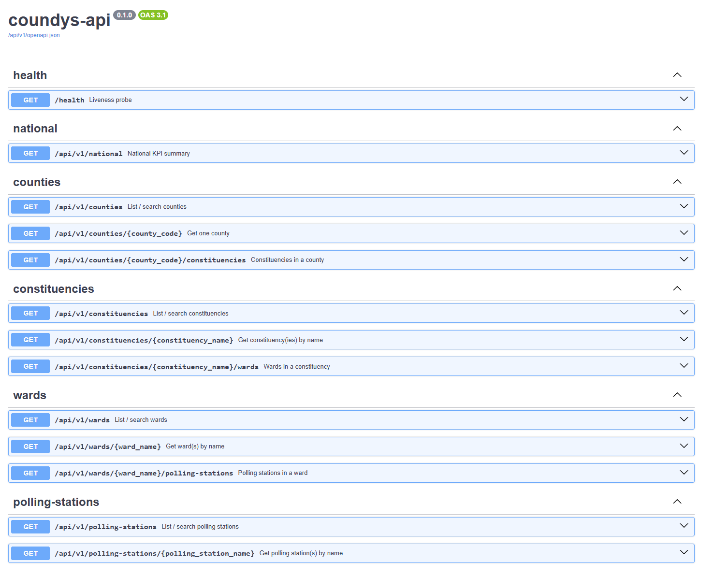

# Coundys
A REST API for accessing Kenya's 2022 General Election registered voter data.

Coundys transforms the IEBC's 712-page voter registration PDF into a searchable API, making it easy to retrieve registered voter counts from the national level down to individual polling stations.

## Features

- 🇰🇪 National voter summary
- 🏛️ Counties
- 🗳️ Constituencies
- 📍 Wards
- 🏫 Polling stations
- 👥 Registered voter counts (2022)
- 📖 OpenAPI 3.1 documentation

## API Documentation

https://coundys.co.ke/docs

## Example Endpoints

```http
GET /api/v1/national

GET /api/v1/counties

GET /api/v1/counties/047

GET /api/v1/counties/047/constituencies

GET /api/v1/wards?name=Kilimani

GET /api/v1/polling-stations?name=Moi%20Avenue%20Primary
```

## Frontend

`frontend/` is a React + Vite dashboard (County Electorate Explorer) built on the API:

- **Overview**: national totals for the selected election year, change vs the previous year, top counties.
- **Compare**: pick up to 8 counties, constituencies or wards and compare two election years.

Local development (expects the API on `http://localhost:8000`; override with `API_PROXY_TARGET`):

```bash
cd frontend
npm install
npm run dev
```

In Docker, the `frontend` service serves the built app on port 80 and proxies `/api/` to the `api` service.

## Tech Stack

- Python
- FastAPI
- PostgreSQL
- Docker
- nginx
- OpenAPI 3.1

## Data Pipeline

```
IEBC PDF
    │
    ▼
Python Extraction
    │
    ▼
Bronze (Raw)
    │
    ▼
Silver (Cleaned)
    │
    ▼
Gold (Aggregated)
    │
    ▼
FastAPI
```

## Why Coundys?

The project started with a simple question:

> Why should anyone have to scroll through a 712-page PDF just to find the registered voter count for a polling station?
<p align="center">
  
</p>
Coundys makes Kenya's voter registration data searchable, accessible, and developer-friendly.

## License

MIT